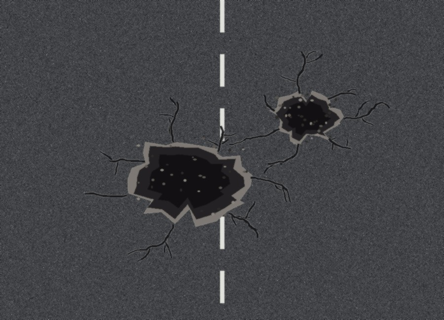
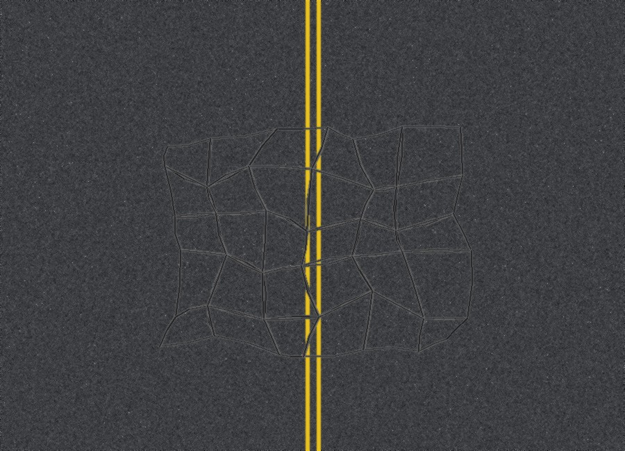
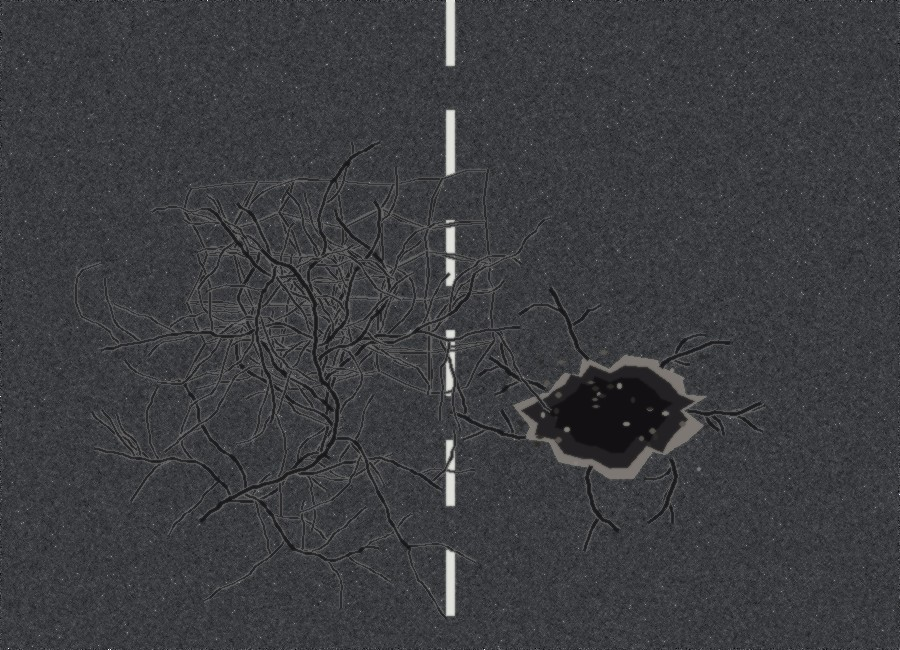
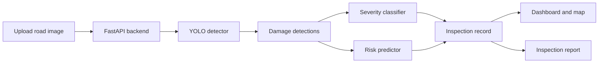

# RoadSense AI

<div align="center">

**AI-powered road damage detection, severity assessment, risk prediction, and inspection reporting**


</div>

RoadSense is a full-stack road inspection platform that converts road images into structured damage assessments. It includes annotated detection results, severity and risk estimates, geospatial inspection data, JWT authentication, dashboards, inspection history, and report generation.

> [!IMPORTANT]
> **Demo mode is enabled when trained model weights are unavailable.** Detection, severity, and risk results may then be simulated. They are not validated for real-world road safety decisions.

## Features

- Upload JPG, JPEG, or PNG road images
- Annotate potholes, cracks, and surface damage
- Classify severity as Low, Medium, High, or Critical
- Estimate risk and suggested repair priority
- Add latitude, longitude, address, and road name
- View geolocated inspections on an interactive Leaflet map
- Browse and manage inspection history
- Review dashboard statistics and recent activity
- Generate structured inspection reports
- Register and log in with JWT authentication
- Use an in-memory fallback when MongoDB is unavailable

## Demo Preview

Sample road images are included in `frontend/public/sample_roads/`.

| Pothole | Alligator crack | Surface damage |
|---|---|---|
|  |  |  |

## How It Works



The system supports these damage categories:

- Pothole
- Longitudinal crack
- Transverse crack
- Alligator crack
- Surface damage

## Technology Stack

| Area | Technology |
|---|---|
| Frontend | React 18, Vite 5, React Router |
| Styling | Tailwind CSS |
| UI | Framer Motion, Lucide React |
| Charts | Recharts |
| Maps | Leaflet, React-Leaflet, OpenStreetMap |
| Backend | Python 3.11, FastAPI, Uvicorn |
| Database | MongoDB 7, Motor |
| Vision | Pillow, OpenCV, NumPy |
| ML | YOLO integration, scikit-learn, joblib |
| Authentication | JWT, python-jose, bcrypt/passlib |
| Reporting | ReportLab |
| Deployment | Docker Compose, Windows batch scripts |

## Quick Start

### Prerequisites

- Python 3.11 or newer
- Node.js 20 or newer
- npm
- MongoDB 7 or Docker Compose

### Windows

From the project root:

```bat
start_all.bat
```

This starts the backend at `http://localhost:8000` and the frontend at `http://localhost:5173`.

Use the separate scripts for manual service control:

```bat
run_backend.bat
run_frontend.bat
```

## Manual Installation

### 1. Clone the repository

```bash
git clone https://github.com/<your-account>/<your-repository>.git
cd <your-repository>/roadsense
```

### 2. Configure the backend

```bash
cd backend
copy .env.example .env
```

Update `.env` with your settings:

```env
MONGODB_URL=mongodb://localhost:27017
DB_NAME=roadsense
SECRET_KEY=replace-with-a-long-random-secret
CORS_ORIGINS=http://localhost:5173
MAX_IMAGE_SIZE_MB=10
UPLOAD_DIR=uploads
```

### 3. Start the backend

```bash
python -m venv .venv
.venv\Scripts\activate
pip install -r requirements.txt
python -m uvicorn main:app --reload --host 0.0.0.0 --port 8000
```

Backend endpoints:

- API: http://localhost:8000
- Swagger: http://localhost:8000/docs
- ReDoc: http://localhost:8000/redoc
- Health: http://localhost:8000/health

### 4. Start the frontend

Open a second terminal:

```bash
cd frontend
npm install
npm run dev
```

Open http://localhost:5173.

Vite proxies `/api` and `/uploads` to `http://localhost:8000`.

## Docker

Start MongoDB, the backend, and the frontend:

```bash
docker compose up -d
```

Useful commands:

```bash
docker compose ps
docker compose logs -f
docker compose down
```

| Service | URL |
|---|---|
| Frontend | http://localhost:5173 |
| Backend | http://localhost:8000 |
| API documentation | http://localhost:8000/docs |
| MongoDB | localhost:27017 |

Remove persistent Docker volumes:

```bash
docker compose down -v
```

## Demo Account

```text
Email: inspector@roadsense.ai
Password: demo12345
```

Change or disable this account before a public deployment.

## API Overview

### Authentication

| Method | Endpoint | Description |
|---|---|---|
| `POST` | `/api/auth/register` | Register a user |
| `POST` | `/api/auth/login` | Log in and receive a JWT |
| `POST` | `/api/auth/token` | OAuth2-compatible login |
| `GET` | `/api/auth/me` | Get the current user |

### Inspections

| Method | Endpoint | Description |
|---|---|---|
| `POST` | `/api/detection/analyze` | Upload and analyze an image |
| `GET` | `/api/detection/{id}` | Retrieve an inspection |
| `DELETE` | `/api/detection/{id}` | Delete an inspection |
| `GET` | `/api/inspections/` | List inspections |
| `GET` | `/api/dashboard/stats` | Get dashboard statistics |
| `GET` | `/api/dashboard/map-data` | Get map inspection data |
| `GET` | `/api/dashboard/recent` | Get recent inspections |

### Reports

| Method | Endpoint | Description |
|---|---|---|
| `POST` | `/api/reports/generate/{detection_id}` | Generate a report |
| `GET` | `/api/reports/` | List reports |
| `GET` | `/api/reports/{report_id}` | Retrieve a report |
| `GET` | `/api/reports/inspection/{detection_id}` | Find a report for an inspection |

## Project Structure

```text
roadsense/
├── backend/
│   ├── database/          # MongoDB connection
│   ├── ml/                # Detection, severity, risk, and report modules
│   ├── models/            # Pydantic schemas
│   ├── routes/            # FastAPI endpoints
│   ├── utils/             # Authentication and helpers
│   ├── config.py
│   ├── main.py
│   └── requirements.txt
├── frontend/
│   ├── public/sample_roads/
│   └── src/
│       ├── components/
│       ├── config/
│       ├── context/
│       ├── hooks/
│       ├── pages/
│       └── utils/
├── docker-compose.yml
├── start_all.bat
├── run_backend.bat
└── run_frontend.bat
```

## Production Checklist

- Add validated YOLO weights and custom ML models
- Replace the default JWT secret and demo account
- Restrict CORS and authentication policies
- Configure HTTPS and a production database
- Use persistent object storage for uploads
- Add file scanning and upload validation
- Configure database backups
- Add automated tests and CI/CD
- Require human verification of all AI-generated assessments

## Troubleshooting

| Problem | Solution |
|---|---|
| Frontend cannot reach the API | Confirm the backend is running on port 8000 |
| MongoDB connection warning | Start MongoDB or Docker; in-memory fallback may be used |
| Login fails | Check the demo credentials or register a new account |
| Upload is rejected | Use JPG, JPEG, or PNG and verify the size limit |
| Detection results look random | The app is in demo mode because no trained weights are configured |

## Contributing

1. Fork the repository.
2. Create a feature branch.
3. Make focused frontend or backend changes.
4. Run the relevant builds and tests.
5. Open a pull request with a clear description and screenshots when useful.

## License

Licensed under the [MIT License](LICENSE).

Copyright (c) 2026 Lalit Dash
